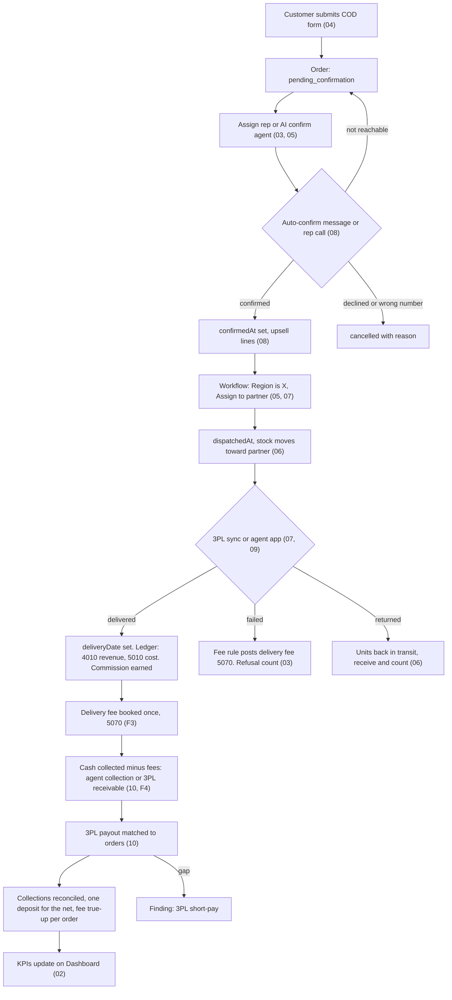
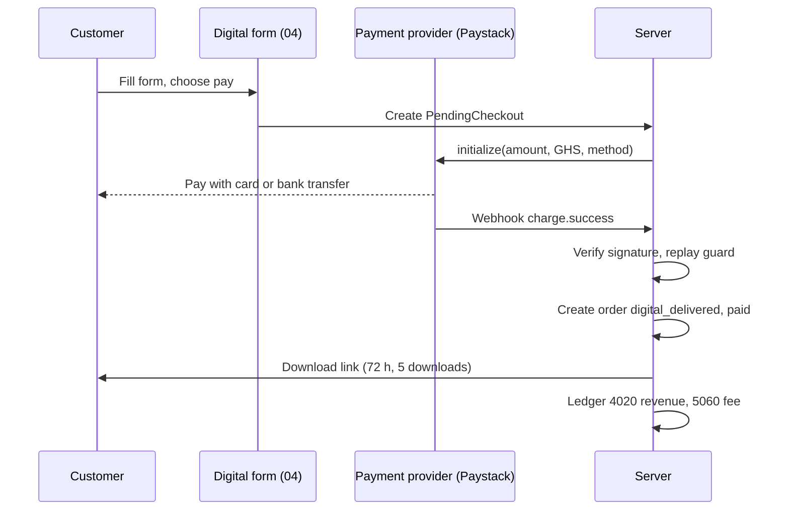
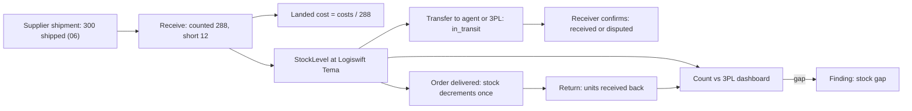
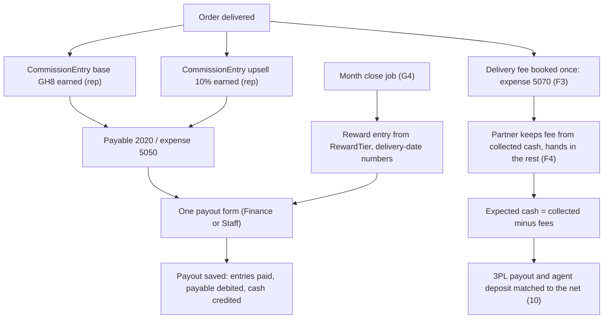
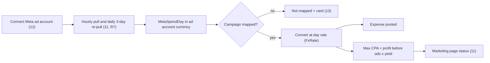
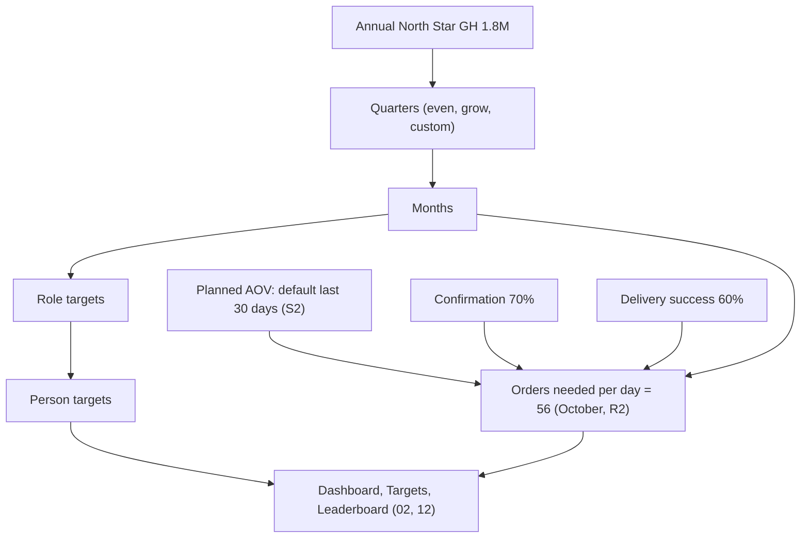
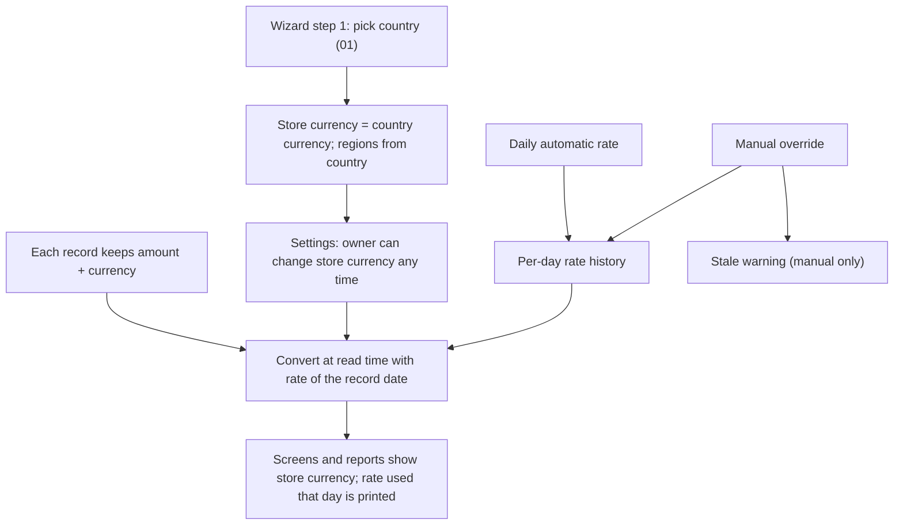
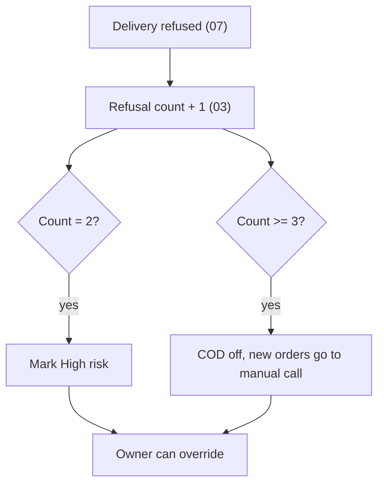
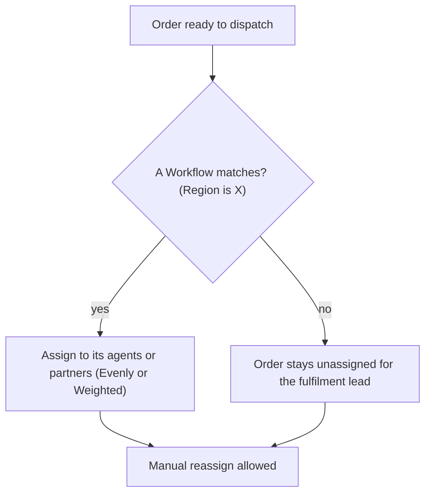
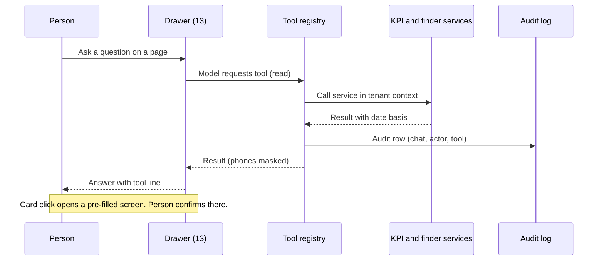

# CodAdmin rebuild: Product Requirements Document

Date: 2026-10-18. Status: draft for owner review. Owner: Manny (Manny Dynamics Limited).
Main author of this file: Builder A. Area files 01 to 13 are in `docs/prd/areas/`.

How to read this document:
- This file is the map. The area files hold the detailed requirements (F-IDs with acceptance criteria).
- Owner decisions in `docs/prd/decisions.md` are final. This PRD never reopens them.
- The 13 locked decisions of the design doc (`docs/superpowers/specs/2026-10-18-codadmin-rebuild-design.md`, section 3) are final too.
- GUESS means a source did not prove the statement. The text says how to check it. UNVERIFIED means a price or rule came from a source we did not confirm.
- Abbreviations: COD = cash on delivery. 3PL = third-party logistics company. GL = general ledger. MCP = Model Context Protocol. CPA = cost per order placed. KPI = key performance indicator. CAPI = Meta Conversions API. AOV = average order value.

---

## 1. Executive summary

### 1.1 Overview
CodAdmin is a COD order admin built for one seller first: Manny Dynamics (Magic Groove copybooks, sold in Ghana, delivered by Logiswift and by delivery agents). This PRD defines the rebuild. The rebuild gives the owner one place to run the business, one definition for each number, matching of orders against cash against stock, team roles, a new design (approved v2 mockups) and a read-first AI assistant.

### 1.2 Background
- The 2026 North Star is GH₵1,800,000 delivered revenue at 35% net margin.
- 1 to 17 October 2026: 1,445 orders placed, 1,026 confirmed (71%), 376 delivered, GH₵92,000 delivered revenue, Meta spend ₦8.53M (GH₵76,200), CPA ₦5,903.
- Orders run ahead of plan (85 a day against 56 needed in October: real days in the month, decision R2). Delivery success (48% against a 60% target) is why revenue lags. Order-to-cash yield is about 34%.
- The audit found four revenue definitions, a rep success-rate bug, no stock locations, no payout reconciliation for Logiswift, and tenant isolation that fails open.

### 1.3 Objectives and metrics
| Objective | Metric | Now (1 to 17 Oct) | Target | Area files |
|---|---|---|---|---|
| One definition per number | Endpoints that disagree on revenue for the same range | 4 definitions | 0 (contract test passes on the fixture) | 02 |
| Revenue on plan | Delivered revenue per month | GH₵92k (projected GH₵167.8k by the written formula, decision R1) | GH₵180k a month | 02, 12 |
| Fix the real leak | Delivery success rate | 48% | 60% | 07, 08, 09 |
| Fix the real leak | Order-to-cash yield | 34% | 42% | 02, 11 |
| Keep orders on plan | Confirmation rate | 71% | 70% or more | 03, 08 |
| Fast first call | Median time to first call, inside operating hours | 9 min overall | Under 15 min; alert at 30 min | 08 |
| Margin | Net margin (delivery date) | 12% year to date; October -16% | 35% | 10 |
| Cash matches orders | Partner payout short (expected = cash collected minus fees, decision F4; sample: Logiswift) | GH₵840 in the mockup sample; the build recomputes it from the formula (R1) | GH₵0 with no hand work | 10 |
| Stock matches | Stock gap per location | 12 units (Logiswift 88 vs 100) | 0 | 06 |
| Cash not stuck | Delivered orders unpaid past days-to-pay | 38 orders over 8 days | 0 | 10 |
| Safe tenants | Two-tenant isolation tests | Not run | All pass | 01 |
| Useful AI | Chat answers match KPI services | No chat | 100% of numbers come from tools | 13 |

### 1.4 Scope
In scope (this rebuild):
- Full redesign to the approved v2 mockups: admin shell, 20 screens, a call-rep screen, a delivery-agent phone app.
- KPI services with one definition per number.
- Stock locations, shipment receiving, landed cost, transfers, counts.
- Fee rules, partner settlements, auto-reconcile, findings (fraud as matching).
- Roles as position contracts, targets (North Star to person), rewards at month close.
- Rep commission GH₵8 plus 10% upsell, only for orders a rep confirms by call (P6). One delivery fee rule per partner, booked once and kept by the partner from the cash it collects (F1 to F4).
- Meta ad spend pull, campaign mapping, max CPA.
- Inbox, reminders, team threads, message tracking.
- Payments behind a provider interface (Paystack kept and works as today, decision O2).
- A country-agnostic app: the owner picks a country; the store currency and the regions follow it (decision O3). English only.
- AI drawer, suggestion cards (read only), tool registry, MCP identity and audit. AI write tools in M12.
- Correctness base (M0): tenant isolation, migrations, Float to Decimal money.

Out of scope (see also design doc section 2):
- Seller SaaS: signup, billing enforcement, messaging wallet, seller onboarding (code stays behind a flag; Billing tab and plans stay visible, decision G2).
- Multi-store per login (decision D7).
- A sync screen, sync status or sync controls for any partner, Logiswift included. Agents run partner syncs outside the app and call one generic "record partner payout" action (decision O1).
- Paystack Ghana and Ghana mobile money (Ghana sells by COD, decision O2).
- Kanban board for orders. XP, levels, streaks. Airtime rewards (decision D9).
- AI writes before M12. Android tap-to-call. Payouts to AI agents or companies.
- Any language other than English. The app is English only (decisions D1, O3).
- Saved reports, recent exports and PDF (decision G8).
- Platform admin redesign (pages stay as they are).

---

## 2. Problem and personas

### 2.1 Problem
The owner cannot trust the numbers, cannot see where cash and stock disappear, and cannot see who is on or off target. Four revenue definitions disagree. Logiswift pays a lump sum that nobody matches to orders. Stock has no location. Call reps and delivery agents have no clear targets, pay or screens. The current UI is a flat 12-item menu without roles.

### 2.2 Personas
The owner holds several of these today (finance clerk and marketer). The app must work when the owner hands a role to a person or an AI agent.

| Persona | Needs | Base role in the app (`UserRole`) | Main screens |
|---|---|---|---|
| Owner (Manny) | On or off track for the North Star each day; find leaks; set targets and pay | `super_admin` | Dashboard, Targets, Finance, Staff, Settings |
| Marketer | Spend, funnel, max CPA, which campaign to cut or scale | `manager` with Marketing permission (GUESS: no marketer base role exists; a `Role` record carries it; check in area 12) | Marketing, Reports |
| Call-centre manager | Queue size, oldest wait, time to first call, confirmation rate per rep | `manager` | Orders, Reports (Team), Staff |
| Call rep | A queue, a call card, outcomes, upsell, own earnings | `sales_rep` | Rep screen (Today, Queue, My orders, Earnings, My numbers, Inbox) |
| Fulfilment lead | Waiting to dispatch, partner success rate, returns missing | `manager` (GUESS) | Deliveries, Orders, Inventory |
| Delivery agent | Today's deliveries, complete or report failed, stock received, cash to deposit | `delivery_agent` | Agent phone app |
| Finance clerk | Collections to verify, payouts, unpaid delivered, expenses, books | `accountant` | Finance |
| Stock keeper | Stock by location, receive shipments, transfers, counts | `inventory_manager` | Products, Inventory and stock |
| AI agent | Read tools (later write tools) under a role; scored under that role; no payout | User `kind = ai_agent`, base role of the role it holds | MCP, chat |
| 3PL company (Logiswift, Kasapa Express) | Delivers orders, collects cash, pays a lump sum less charges; no login in this release | User `kind = company`, `delivery_agent` base (as today) | Outside agents use the normal API or MCP key (O7); shown in Deliveries and Finance |

The owner may add two further people later: an admin (`admin`) and a platform admin (`isPlatformAdmin`, outside the tenant).

---

## 3. UI mockups

All mockups are in `docs/mockups/v2/`. The owner approved them (rounds 1 to 3). They use `app.css` and the tokens in `DESIGN-SPEC.md`. The numbers on every page follow `NUMBERS.md`. Where a mockup disagrees with a decision, the decision wins and the gap matrix section 4 lists the fix.

| File | What it shows | Area file |
|---|---|---|
| `index.html` (5 views) | `#dash` Dashboard (target ladder, today's targets, driver tiles, chart, agent cards); `#orders` Orders (table, assign per row and in bulk, drawer, new order, import); `#targets` Targets; `#board` Leaderboard (Call reps, Delivery, Upsell); `#onboard` North Star setup wizard | 02, 03, 12 |
| `rep.html` | Call-rep app: Today, Queue with call card and upsell panel, My orders, Earnings, My numbers, Inbox | 08 |
| `agent.html` | Delivery-agent phone app: Home, Deliveries, detail, complete and failed sheets, Stock, confirm received, Cash, New deposit, Inbox, More | 09 |
| `inbox.html` | Inbox feed (All, Mentions, Alerts, Done), Reminders, Team threads, Assigned to me, notification settings | 05 |
| `customers.html` | Customers list and segments (first-time, repeat, refused before, not reachable) | 03 |
| `checkout-forms.html` | Form list, editor tabs (Basics, Fields, Packages, Upsells, Design, Payment, Tracking), preview | 04 |
| `messages.html` | Conversations, Scheduled, Bulk send, Campaigns, Templates, Opt-outs; status per message | 05 |
| `products.html` | Catalog, incoming shipments, product drawer, add shipment, receive shipment, stock modals, transfer history | 06 |
| `inventory.html` | Stock by location, transfers, adjust, allocate, count | 06 |
| `deliveries.html` | Partners (agents and 3PLs), success rate, days, fee rules, failed and returned by reason, returns missing | 07 |
| `finance.html` | Overview, collections, review modal, accounting (ledger, statements, profit by product, expenses), rep commissions, payouts, forecast | 10 |
| `marketing.html` | Funnel per campaign, spend against orders, max CPA, ad drilldown with hook and hold, mapping status | 11 |
| `reports.html` | Tabs Overview, Sales, Delivery, Team, Products, Marketing; export dialog | 11 |
| `staff.html` | Roles with contracts, team and pay, person modal, payout modal | 12 |
| `workflows.html` | Workflow list, builder, auto-assign by region | 05 |
| `connections.html` | Arkesel, WhatsApp, email, Paystack, order-import webhooks, MCP keys, Meta Ads | 04, 12 |
| `settings.html` | Profile, Security, Business, North Star and targets, Rewards, Currencies and FX, Order statuses, Notifications, Billing and plans | 12 |
| `app.css`, `DESIGN-SPEC.md`, `NUMBERS.md` | Tokens and components; design rules; canonical numbers | all |

Notes:
- The mockups show only the owner. Menus and homes for other roles are specified in area 01 (F-102).
- The mockup "sample data" pill, the "2 stores" chip, Download report, Add status and about 40 dead buttons are not built (area 01 F-111).
- The mockup files themselves are not edited by this PRD.

---

## 4. Index of area files

| File | F-ID range | One line |
|---|---|---|
| `areas/01-shell-auth-admin.md` | F-100 to F-199 | Shell, role menus, command palette, auth, onboarding wizard shell, platform admin, tenant isolation, migrations, Decimal money, test gate |
| `areas/02-dashboard.md` | F-200 to F-299 | Owner dashboard and the KPI services behind it (one revenue, three rates, pace and projection) |
| `areas/03-orders-customers.md` | F-300 to F-399 | Orders, order state machine, assign, customers, refusal rule |
| `areas/04-checkout-payments.md` | F-400 to F-449 | Checkout forms, payment provider interface, Paystack, digital orders |
| `areas/05-messages-workflows-inbox.md` | F-450 to F-599 | Messages and tracking (F-450), workflows (F-500), inbox, reminders, threads (F-550) |
| `areas/06-products-stock.md` | F-600 to F-699 | Products (F-600), inventory, locations, shipments, landed cost, counts (F-650) |
| `areas/07-deliveries.md` | F-700 to F-749 | Delivery partners, fee rules, returns missing |
| `areas/08-rep-screen.md` | F-750 to F-799 | Call-rep app, call card, upsell, earnings, auto-confirm, queue timer |
| `areas/09-agent-app.md` | F-800 to F-899 | Delivery-agent phone app |
| `areas/10-finance-pay.md` | F-900 to F-999 | Finance, settlements, ledger, findings, payout form, delivery fee posting |
| `areas/11-marketing-reports.md` | F-1000 to F-1099 | Meta spend, mapping, max CPA (F-1000); reports and export (F-1050) |
| `areas/12-targets-staff-settings.md` | F-1100 to F-1299 | North Star, targets, rewards, leaderboard (F-1100); staff and roles (F-1150); connections and settings (F-1200) |
| `areas/13-ai-mcp.md` | F-1300 to F-1399 | Tool registry, MCP identity, audit, chat drawer, suggestion cards, write tools |

The ranges for areas 03 to 12 come from the writing plan. The area files are the source for exact IDs.

---

## 5. Cross-screen flows

Each flow lists numbered steps and a diagram. Area numbers point to the file that holds the requirement. GL codes are the live codes in `backend/src/config/glAccounts.ts` (1010 cash in hand, 1015 cash in transit, 1020 receivable from agents, 1200 inventory, 2020 commissions payable, 4010 product revenue, 4020 digital revenue, 5010 cost of goods, 5020 failed delivery expense, 5030 return processing, 5040 delivery agent commission, 5050 sales rep commission, 5060 payment fees, 5100 operating expense). The design doc calls commissions payable "GL 2100". The live code is 2020 (gap-matrix extra E1). Area 10 sets the exact debit and credit pairs and the new accounts (2040 unapplied receipts, 2050 supplier payables, 3010 equity, 5070 delivery fees, 5080 Meta ad spend). There is no pay-per-delivery for agents account (decision F1). Account 5040 stops receiving postings.

### 5.1 Order to cash
1. Checkout (area 04, public form). A customer fills the form. The order is created as `pending_confirmation`. Data: `Order`, `OrderItem`, `Customer`. Meta CAPI Purchase mirror fires. Ledger: none yet.
2. Assignment (areas 03, 05). A workflow assigns the order to a call rep or the AI confirm agent (split evenly or weighted; a condition such as "Region is X" picks who is eligible; state kept in Redis or the database). Data: `Order.assignedRepId`.
3. First contact (area 08). The auto-confirm message goes out by WhatsApp or SMS at once, also outside operating hours (area 05, decision P4). A rep calls from the queue. Time to first call is the time to the first rep call attempt, inside operating hours only (G5, R10); a customer YES to auto-confirm confirms the order and closes the clock as "auto-confirmed". Target 15 minutes, alert at 30 (D6). A customer NO does not cancel: the order goes to the call queue with a "said NO" flag and a rep calls once before any cancel (P2).
4. Call outcome (area 08). Confirmed sets `confirmedAt` and status `confirmed`; commission is earned only for orders a rep confirms by call (P6). Declined sets `cancelled` with a reason. Wrong number sets `cancelled` with reason "wrong number". Not reachable keeps `pending_confirmation` and logs the call (E3).
5. Upsell (area 08). The rep adds more units, a higher package or an add-on. `UpsellLine` rows are written and the order total rises. The 10% reward waits for delivery.
6. Dispatch (areas 03, 07). The fulfilment lead (or a workflow with a "Region is X" condition and an "Assign to" action, decision O4) assigns a partner. If no workflow matches, the order stays unassigned for the fulfilment lead. Data: `dispatchedAt`, partner on the order. Stock moves from the own store or the partner location toward the partner (area 06).
7. Delivery (areas 07, 09). A 3PL status arrives from an outside agent that calls the API or an MCP tool (decision O1). An agent completes it in the phone app. Outcomes: delivered, failed, returned.
8. Delivered. Status `delivered`, `deliveryDate` set. Ledger: revenue 4010 dated by delivery date; cost of goods 5010 against inventory 1200; cash held by the partner as a receivable (area 10 fixes the account split, gap-matrix section 3 row 8). `CommissionEntry` rows become `earned`: GH₵8 base plus 10% upsell for the rep who confirmed it by call (P6). The delivery fee posts once as a delivery fee expense (5070) and the partner keeps it from the cash it collects (F1 to F4). Stock may go negative at delivery; that raises a Finding and does not block the delivery (R11).
9. Failed or returned. The delivery fee from the partner's fee rule posts once, to 5070 (decision F3; Logiswift charges nothing on failed). Returned: units go back in transit and must be received (area 06). Customer refusal count rises (G6).
10. Cash collected. The partner keeps the delivery fee from the cash it collects and hands in the rest, so expected cash = cash collected minus fees (F4). Agent cash: `AgentCollection` moves draft, verified, approved, deposited, reconciled (area 10). 3PL cash: sits in the receivable until the payout.
11. Payout matched (area 10). An outside agent calls the one generic "record partner payout" action (API route and MCP tool) with the paid-order list and the payout. It works the same for every partner (decision O1). A `PartnerSettlement` with lines matches orders and collections, moves matched collections to `reconciled`, records one `AgentDeposit` for the net amount, and trues up each order's delivery fee from the Charge column. A gap opens a `Finding`.
12. Revenue and delivery fees are booked. The KPI services show the result on the Dashboard (area 02).



### 5.2 Digital paid order
1. A customer opens a digital form (Smart Parent's guide, GH₵59). The form offers online payment only (area 04).
2. The form calls the payment provider interface (G1). A `PendingCheckout` row and a provider reference are created. The customer pays with the methods the provider offers (card or bank transfer).
3. The provider webhook arrives (`charge.success`). The handler checks the signature and the replay guard (`WebhookEvent`), then creates the order. Status `digital_delivered`, payment status `paid`. Today the order is created on settlement.
4. The service issues a signed download link (default 72 hours, 5 downloads) and sends it by email or WhatsApp (areas 04, 05). `deliveryDate` is the time the link is issued (GUESS: check `paystackSettlementService.ts`).
5. Ledger: digital revenue 4020, provider fee 5060 (area 10). CAPI Purchase fires with event-id dedupe.
6. Revenue rule (D8): a paid digital order counts as delivered revenue. A free bundled digital item adds GH₵0 and does not count. The KPI service includes `digital_delivered` paid orders (area 02 F-250). Digital orders stay out of the confirmation and delivery success rates.



### 5.3 Stock
1. Supplier shipment (area 06). The stock keeper adds a shipment: supplier, units shipped (example: 300 from Accra Print House on 9 October), unit cost, shipping, customs, other.
2. Receive (area 06). At the destination location (Logiswift warehouse, Tema) the keeper records counted units (288). Short = 12 (`shortQuantity`).
3. Landed cost per unit = (unit cost × shipped + shipping + customs + other) ÷ counted (decision D2). The owner set GH₵30 per set on 18 October; the app computes it from the shipment.
4. Locations (area 06). `StockLevel` holds quantity per location and product. `Product.stockQuantity` becomes the sum.
5. Transfer to a 3PL or an agent (areas 06, 09). `InventoryTransfer` goes `in_transit`, then the receiver confirms (agent app or 3PL count) to `received`, or marks `disputed`.
6. Sale (areas 03, 06). Stock decrements once per order, on the event area 06 defines. A test must prove that a public order that is delivered decrements once (gap-matrix section 3 row 7).
7. Return (areas 03, 06). Returned units are received at a location. The 3PL's "sent back" count is compared with ours (returned units missing, target 0).
8. Count (area 06). A periodic count against the 3PL dashboard writes `StockCount` lines. A gap opens a `Finding` (example: system 100, counted 88, gap 12).



### 5.4 Money and pay
1. Rep commission (area 10). When an order that a rep confirmed by call is delivered, a `CommissionEntry` of kind `base` for GH₵8 becomes `earned` (P6). Auto-confirmed orders earn none. Ledger: expense 5050, payable 2020.
2. Upsell reward (area 10). A `CommissionEntry` of kind `upsell` for 10% of the extra value becomes `earned` on delivery. Example: Adwoa GH₵6,100 extra value gives GH₵610.
3. Delivery fee (decisions F1 to F4, area 10). The fee is what we pay whoever delivers, a 3PL or an own agent. Each partner has one fee rule in Settings: a fee per delivered, failed and returned order (sample: Kofi GH₵25 per delivered). When the outcome happens, the fee is booked once as a delivery fee expense (5070) with no second expense and no extra P&L line. The partner keeps the fee from the cash it collects and hands in the rest. Expected cash from a partner = cash collected − fees. The 3PL payout and the agent deposit are matched against that net amount. The payout form never pays a fee. The agent app shows "fees you kept" instead of any pay owed.
4. Rewards (decision G4, area 12). At month close the job computes attainment on delivery-date numbers and creates reward entries from `RewardTier`. Cash tiers only (D9): Call rep 100% GH₵300, 120% GH₵500 plus a paid day off; Delivery 100% GH₵250, 120% GH₵400 plus a paid day off. Companies and AI agents get no payout.
5. One payout form (area 10, decision in gap-matrix section 4 row 5, Q3). Finance and Staff both open the same modal. It lists all earned and unpaid commission, upsell and target reward entries for a person. It has no delivery fee line (F4). Saving creates a `Payout`, marks entries `paid`, and posts payable debit and cash credit.
6. Example (NUMBERS.md): Adwoa owed 2,024 + 610 − 600 paid = GH₵2,034. Nana owed 104 + 30 = GH₵134. Commissions payable GH₵2,168.
7. Net margin in the P&L: revenue − product cost − delivery fees (one line, 3PL and agents together) − rep commission (its own line) − ad spend − other expenses. October margin is about −16% once the commission line is in (formula wins, R1; decision R6); updated 2026-10-19. NUMBERS.md was refreshed on 2026-10-19 and no longer has the old pay-per-delivery for agents GH₵12/10.



### 5.5 Meta spend, campaign mapping, max CPA
1. Connect (areas 11, 12). The owner connects the Meta ad account in Connections (`MetaConnection`, token encrypted). Scopes and App Review must be checked first (UNVERIFIED).
2. Hourly and daily pull (area 11, decision R7). A Bull job pulls today's spend every hour. A second run re-pulls the last 3 days once a day for the final figures. Both write to `MetaSpendDay`. Spend is in the ad account's currency, taken from the Meta ad account automatically (O5). The original amount and currency stay on the row.
3. Mapping (area 11). A mapping screen links each campaign to a product by name rule or by pick. Unmapped campaigns show "Not mapped" and raise card C-03.
4. Conversion. Spend converts to the store currency at the stored rate for that day (`FxRate`; daily automatic, manual override, per-day history; stale warning only for manual rates; decisions O5, O6). The ₦ and GH₵ figures in this section are sample values for the Manny Dynamics store.
5. Spend posts to the ledger as an expense.
6. Max CPA = profit per delivered order before ads × order-to-cash yield. Copybook: GH₵185 = ₦20,720 (249 − 30 landed cost − 34 delivery fee; 34 is the sample value, the build uses the weighted fee from the partners' fee rules, decision R5). At 34% yield: ₦7,040. At 42% yield: ₦8,700. The fixed ₦6,400 ceiling is gone.
7. The Marketing page shows each campaign against its max CPA, and status (Winning, On track, Over max CPA, Not mapped, Paused).



### 5.6 North Star setup
1. Wizard (area 01 F-124, area 12). Step 1 store, step 2 first 3PL, step 3 annual North Star (GH₵1,800,000), step 4 driver targets, step 5 invite team, step 6 rewards link.
2. Annual North Star splits into quarters: even each month, grow each quarter (Q1 360k, Q2 420k, Q3 480k, Q4 540k), or custom. Quarters split into months. Months split into role and person targets.
3. Drivers (S2, R12): planned AOV (default = average value of delivered orders in the last 30 days; the owner edits it), confirmation rate 70%, delivery success rate 60%. Result: GH₵180,000 ÷ 249 = 723 delivered; ÷ (0.70 × 0.60) = 1,721 orders; ÷ 31 days in October = 56 orders a day (real days in the month, decision R2).
4. Max cost per order is computed (not typed): ₦20,720 × yield.
5. Reward tiers are not set here (S1). The page shows a one-line link to Settings, Rewards.
6. The Dashboard, Targets and Leaderboard read these targets.



### 5.7 Store setup and currencies (O3, O5, O6)
1. In wizard step 1, the owner picks the country. The store currency is that country's currency and is set automatically. The regions list comes from the chosen country (country-state-city data). The app is English only.
2. The store currency is not locked. The owner can change it in Settings at any time. All figures then show in the new currency, converted with the per-day rate history.
3. All money shows in the store currency. An amount in another currency (a Meta ad spend in the ad account's currency, a supplier invoice) converts at that day's rate. The original amount and its currency stay on the record.
4. **How amounts are stored (one rule).** Each money record keeps its amount in the currency it was entered in (`amount` plus `currency`). Nothing is rewritten when the store currency changes. Screens, reports and exports convert at read time with the rate of the record's own date (`FxRate`). A record already in the store currency needs no rate.
5. Rates: a daily automatic rate, a manual override, a per-day history. Reports print the rate used for the day. A change of store currency needs a rate for every past day it must show; a missing day uses the nearest earlier rate and shows a note.
6. The stale-rate warning shows only for manual rates (card C-26).
7. Money settings (rep commission, reward tiers, fee rules) are entered in the store currency. GH₵ amounts in this PRD are sample values for the Manny Dynamics store.



### 5.8 Refusal rule (G6)
1. Each failed delivery that the customer refused adds to the customer's refusal count (areas 03, 07).
2. At 2 refusals the customer is marked High risk. Staff see a tag on the order and the customer.
3. At 3 refusals COD turns off for that customer. A new order from them goes to a manual call instead of the normal queue.
4. The owner can override both states on the customer page.
5. Card C-05 lists customers with 2 or more refusals.
6. After the owner overrides COD for a customer, the refusal count restarts at zero (P3).



### 5.9 Assign by region is a Workflow (O4)
1. The owner builds a Workflow. Condition: "Region is X" (workflow conditions already include Region and Country). Action: "Assign to" one or more delivery agents or partners, split Evenly or Weighted.
2. Many agents can serve one region. Weighted uses the same assignment cursor as rep assignment.
3. When an order is ready to dispatch, the matching Workflow assigns it.
4. If no Workflow matches, the order stays unassigned. The fulfilment lead assigns it.
5. The owner or fulfilment lead can reassign by hand, per row or in bulk.
6. There is no coverage grid on Deliveries, no priority order and no fallback partner.



### 5.10 AI read flow
1. A person opens the drawer from any screen (area 13). The page key and filters go with the question.
2. The chat service asks the model with the registry tool list filtered to the person's permissions.
3. The model calls read tools. Each call runs through the registry in the person's tenant and writes an audit row with channel `chat`.
4. The answer streams back with a tool line. Numbers come from tool results only.
5. Suggestion cards use the problem finders. A card button opens a screen with the form pre-filled (G10). The person checks and confirms there. Nothing is saved by the click.
6. External agents use MCP with a key tied to an AI agent user and a role. The role's tool list limits them.
7. From M12, write tools return a preview. A person confirms. The audit log keeps before and after.



---

## 6. Data requirements

Exact fields live in the area files. This section lists the whole set so a planner can see the size of the migration. Names come from design doc section 5.3 plus additions from the decisions and the gap matrix.

### 6.1 New models (design doc 5.3)
`StockLocation`, `StockLevel`, `StockCount`, `StockCountLine`, `FeeRule`, `PartnerSettlement`, `PartnerSettlementLine`, `Finding`, `Role`, `RoleAssignment`, `Target`, `RewardTier`, `CommissionEntry`, `UpsellLine`, `Reminder`, `Thread`, `Comment`, `MessageEvent`, `MetaConnection`, `MetaSpendDay`, `MetaCampaignMapping`, `FxRate`, `AiAction`, `ChatThread`, `ChatMessage`. That is 25 models (`PartnerConnector` was removed by O7). Each has a required `tenantId`, is in the tenant-scoped list, and uses `Decimal(19,4)` for money.

### 6.2 New models and fields added by decisions and by this PRD
| Item | Why | Owner area |
|---|---|---|
| `SuggestionState` (dismiss and snooze per user) | Cards need dismiss and snooze (G10) | 13 |
| Customer risk fields: refusal count, risk level, COD-off flag, override | Refusal rule (G6) | 03 |
| Operating hours and time zone in settings | Time-to-first-call clock (G5, D6) | 12 |
| Planned AOV on the North Star target | S2 | 12 |
| `FxRate` extras: source (`auto` or `manual`), per-day history | O5, O6 | 12 |
| Currency on each money record (`amount` plus `currency`) | Store currency can change; convert at read time (O5, O6) | 01, 10 |
| `CommissionEntry` kind for delivery-agent pay | Removed (decision F1). `CommissionEntry` kinds are `base`, `upsell`, `reward` only. | 10 |
| Reward entries from month close | Reward earned at month close (G4) | 12 |
| Payment provider config per tenant (provider name, keys, methods by country) | Provider interface (G1) | 04 |
| Accounts: delivery fees 5070, Meta ad spend 5080, unapplied receipts 2040, equity 3010, supplier payables 2050 (no pay-per-delivery payable, decision F1) | Gap-matrix E1, R4 | 10 |
| `User.kind` value `system` | Per-tenant system user (area 13 F-1303) | 01, 13 |
| `AiAction` states `expired`, `failed` | Write-flow safety (area 13 F-1316) | 13 |
| `User.deliveryRate` removed; one fee rule per partner replaces it (decisions F1, F2) | Delivery fee (F2) | 07, 10 |

### 6.3 Changed models (design doc 5.3)
`User` (kind; stop using `commissionAmount`; remove `deliveryRate`, decision F1); `Order` (`confirmedAt`, `dispatchedAt`, `firstContactAt`, `declineReason`, `deliveryFee`, `landedCostTotal`; stop using `commissionPaid`); `Call` (`tenantId`, `startedAt`, `source`, `declineReason`; outcomes `not_reachable`, `declined`); `AgentCollection` (`tenantId`, `settlementLineId`, auto `reconciled`); `AgentDeposit` (`tenantId`, `settlementId`); `AgentAgingBucket`, `Payout`, `OrderHistory`, `AuditLog`, `WebhookLog`, `SmsTemplate`, `DownloadToken`, `FormSubmission`, `product_cost_entries` (`tenantId`); `PendingCheckout`, `WebhookEvent` (add to scoped list); `Account`, `JournalEntry` (per-tenant unique); `InventoryShipment` (`receivedAt`, `receivedById`, `quantityCounted`, `shortQuantity`, `destinationLocationId`); `InventoryTransfer` (locations, status, receipt); `MessageLog` (`replied`); `Notification` (subject, actor, snooze, required tenant); `AuditLog` (actor kind, channel, role, before, after, AI action); `McpApiKey` (`userId`, `roleId`); `Expense` (`source`, Decimal); `SystemConfig` (days-to-pay per partner, queue wait target).

### 6.4 Enums
| Enum | Today | Change |
|---|---|---|
| `UserRole` | super_admin, admin, manager, sales_rep, inventory_manager, delivery_agent, accountant | No change. Base permission set. |
| `OrderStatus` | pending_confirmation, payment_pending, confirmed, preparing, ready_for_pickup, out_for_delivery, delivered, digital_delivered, cancelled, returned, failed_delivery, payment_failed (12 values in the schema) | The state machine (area 03, D7) defines allowed moves. Settings shows the real values read-only. The frontend inventory lists 9; the schema has 12 (see section 11). |
| `PaymentStatus` | pending, paid, collected, deposited, reconciled | Keep. Payment moves use `PaymentStatus`, not `OrderStatus` (memory rule). |
| `CallOutcome` | existing | Add `not_reachable`, `declined`. |
| `MessageStatus` | existing | Add `replied`. |
| New | n/a | `UserKind` (person, ai_agent, company, system); `StockLocationType` (own_store, partner_3pl, agent, in_transit); `TransferStatus` (in_transit, received, disputed); `FeeOutcome` (delivered, failed, returned); `FindingType` (cash gap, short-pay, stock gap, unpaid after term, repeat refuser); `TargetScope` (north_star, quarter, month, role, person); `CommissionKind` (base, upsell, plus delivery pay); `CommissionStatus` (pending, earned, paid, void); `UpsellKind` (more_units, higher_package, add_on); `AuditChannel` (app, chat, mcp, connector, system); `AiActionStatus` (proposed, confirmed, done, rejected, expired, failed). |

### 6.5 Money: Float to Decimal (decision D4)
First, in M0, a check on production data finds which money columns hold minor units, `Order.depositPaid` and `Order.balanceDue` first (decision R15). Then all money columns convert from `Float` to `Decimal(19,4)` in M0. The list (29 columns in 14 models) is in area 01, F-154. API money fields become strings with two decimals. A `Money` helper does the arithmetic. August and September stay as booked, with a note (D5). The migration runs on a staging copy first and a script proves zero difference to the cent.

### 6.6 Backfills
- `tenantId` on 12 models (area 01 F-151).
- `confirmedAt`, `dispatchedAt`, `firstContactAt` from `OrderHistory` (GUESS: check that history rows are enough, design doc check 11).
- `StockLevel` from `AgentStock` and `Product.stockQuantity`.
- Reconcile the 1,321 draft collections from app data (aging backfill, design doc risk 10). No portal export is needed (O1).
- `CommissionEntry` from existing commission data.

---

## 7. Technical specifications

### 7.1 Stack
- Frontend: React 18, Vite, TypeScript, Zustand, hand-written UI with v2 tokens, Recharts, socket.io-client.
- Backend: Node 20, Express, Prisma 5, PostgreSQL. Redis with Bull queues. socket.io. Jest, Vitest, Playwright.
- Hosting: host nginx is the edge; Docker serves the built app; Cloudflare R2 for files (memory notes; check `docs/` deploy notes).

### 7.2 Architecture
```
Screens (v2) --> API controllers --> Services (one per area) --> Prisma (tenant-scoped)
Chat drawer / cards                      ^                          ^
MCP clients --> Tool registry -----------+              Meta connector; outside agents (API, MCP)
```
Rules (design doc 5.2):
1. Controllers only call services. Logic in `shipmentController.ts` and in stock code of `productController.ts` moves to services.
2. One KPI service per area. Dashboard, reports, chat and MCP call it.
3. One tool registry (name, schema, service call, permission, read or write flag, confirm mode).
4. Every write goes through a service that posts its own side effects (ledger, stock, history). Workflow actions `update_order` and `assign_agent` stop writing with raw `prisma.order.update`.
5. Every actor has a user row (person, AI agent, company, system).
6. Every new model has a required `tenantId` and is in the scoped list.
7. New money columns are `Decimal(19,4)`.

### 7.3 Queues, jobs and sockets
Existing Bull queues (all 3 attempts, exponential backoff): `agent-aging-refresh`, `financial-reconciliation`, `message-log-cleanup`, `pending-checkout-cleanup`, `workflow-execution`, `email-campaign`. Cron: WhatsApp token refresh, GL balance check, local upload purge.

New jobs (owner area in brackets):
- Meta spend pull: hourly for today, plus a daily re-pull of the last 3 days (11, decision R7).
- FX daily rate (12).
- No settlement job in the app. Outside agents call "record partner payout" (10, decision O1).
- Month close: reward entries and commission close (12, 10).
- Auto-confirm message and queue timer alerts (08, 05).
- Reminder due notifications (05).
- Workflow delayed steps as delayed jobs, replacing `setTimeout` waits (05).
- Nightly check: KPI revenue against GL 4010 and 4020 per day (10).
- Suggestion cache refresh is on demand (13), no job.
Rules: every job and cron sets a tenant context or loops over tenants (area 01 F-150). Repeatable jobs re-register at boot (as today).

Sockets: rooms are `t:<tenantId>:role:<role>`, `t:<tenantId>:user:<id>`, `t:<tenantId>:order:<id>` (area 01 F-110). No global emit for tenant data. Events as today plus `notification`, `ai_action:proposed`, `suggestions:updated` (GUESS: last two optional).

### 7.4 MCP
Stdio and `POST /mcp` stay. Keys tie to an AI agent user and a role. Tools come from the registry, filtered by the role's allow-list. Rate limit per key and per tenant in Redis. Every call writes an audit row. The 14 existing tool names stay, including the write tool `orders_update_status` (no regression, decision R13). New AI writes start in M12. The audit log has an API first and a screen in M11. Details: area 13.

### 7.5 Security
| Item | Requirement | Area |
|---|---|---|
| Null-tenant register risk | Remove public `POST /api/auth/register`. A user without tenant bypasses the tenant extension. Prove with a test, then remove. List existing null-tenant users. | 01 F-122 |
| Fail-open isolation | Query without tenant context on a scoped model throws, unless a named bypass is used. Jobs and public routes set context. | 01 F-150 |
| Unscoped models | Add `tenantId` to 12 models; seed a chart per tenant; per-tenant uniques. | 01 F-151, F-152 |
| Delivery routes | Role and ownership checks | 01 F-126 |
| `GET /api/admin/config` | Resolve tenant or require login | 01 F-126 |
| `/metrics`, `/health/detailed` | Restrict | 01 F-126 |
| Sockets | Tenant-scoped rooms | 01 F-110 |
| Aging refresh | Per tenant; no global `deleteMany({})` | 01 F-150 |
| Legacy Paystack handler | Remove (past 2026-09-01 sunset) | 04 |
| Workflow bypass | Route `update_order` and `assign_agent` through services | 05 |
| Secrets | Provider keys encrypted at rest (`enc:v1:` AES); never in logs, audit rows or model prompts | 12, 13 |
| MCP identity | Actor per call; role allow-list; per-key rate limit | 13 |
| AI data exposure | Phones and addresses masked before data reaches the model; injection tests | 13 |
| Plan limits and tenant status | Display only until SaaS (known gap) | 01 F-123 |
| Roles | Menu and API both use the permission matrix; no hard-coded role lists | 01 F-102 |

### 7.6 Payment provider interface (decision G1)
Keep Paystack. Build payments behind an interface so another provider can replace or join it. Paystack works as today (decision O2).
- `initialize({ reference, amount, currency, customer, method, callbackUrl, metadata })` returns `{ redirectUrl or channelInstructions, providerReference }`.
- `verify(reference)` returns `{ status, amount, currency, fees, paidAt, channel }`.
- `parseWebhook(rawBody, headers)` verifies the signature and returns a normal event `{ type, reference, amount, currency, eventId }`. The caller applies the replay guard (`WebhookEvent`).
- `supportedMethods(country, currency)` returns the methods the Paystack account offers for that country and currency (card, bank transfer).
- `fee(amount, channel)` for the 5060 expense.
- Amounts use minor units inside the adapter only; the app uses Decimal.
- Per-tenant config: provider name, public key, secret key (encrypted), mode, methods by country.
- Prepaid physical orders are a later step (G1 says the business moves toward online payments for physical goods later). The interface must not assume digital only.
Area 04 holds the requirements.

### 7.7 Performance and operations
- Dashboard endpoint answers in under 1 second on the fixture (GUESS target; set a budget in M3).
- Command-palette search under 400 ms on 10,000 orders (area 01 F-105).
- Deploy: staging first; deploy script fails on a failed migration (area 01 F-153).
- Branching: feature branches to `develop` to `main`; one pull request per milestone (memory rule); no direct push to `main`.

---

## 8. Testing requirements

### 8.1 Strategy
1. Unit tests for every KPI function, every registry tool and every pure rule (pace, status tag, landed cost, commission, refusal rule, region assignment).
2. Integration tests against a real test database for services, endpoints and migrations.
3. Two-tenant tests for every new model and every tool: tenant B data never appears for tenant A.
4. Contract tests: all endpoints and tools that return a KPI agree with the KPI service on the fixture.
5. E2E tests (Playwright) for the main flow of each role: owner, manager, finance clerk, stock keeper, call rep, delivery agent.
6. Visual checks: each page in light and dark mode at 1440 px and 760 px.
7. Static checks in CI: wording guard (no "airtime", no "delivery rate", no old pay-per-delivery wording), no dead buttons, no hex colours outside tokens, no tool outside the registry, no raw tenant bypass.

### 8.2 The fixture
One deterministic fixture (area 01 F-114) reproduces `NUMBERS.md` plus January to September revenue. Tests assert: 1,445 placed; 1,026 confirmed (71%); delivered 376; failed 354; returned 48; delivery success 48% (376 ÷ 778); yield 34%; delivered revenue GH₵92,000; orders needed per day 56 (October, 31 days); max CPA ₦7,040 at 34% yield; Logiswift payout short recomputed as cash collected minus fees (the mockup GH₵840 is a sample, decisions F4, R1); Magic Groove 288 counted, 12 short, 12-unit gap at Logiswift (88 vs 100); Adwoa owed GH₵2,034.

### 8.3 Gates
- Backend gate today: lines 37%, branches 25%. It never drops, and rises at M5 and M11 (area 01 F-156).
- A baseline run of both suites happens in M0. Whether they pass today is unknown.
- Each milestone's pull request must pass build, lint, unit, integration and the static checks.
- Migrations: CI builds an empty database with `migrate deploy` and diffs it against the schema file.

### 8.4 Per-area tests
Each requirement in each area file lists its own unit, integration and E2E items. This section does not repeat them.

---

## 9. Success metrics

Source: design doc section 4 (KPI dictionary). Each has one formula, one date basis and one owner role.

| Metric | Formula | Date basis | Target | Now | Owner role |
|---|---|---|---|---|---|
| North Star revenue | Sum of `totalAmount` of delivered orders (plus paid digital) | Delivery date | GH₵1,800,000 in 2026 (GH₵180,000 a month) | GH₵1.38M year to date; GH₵92k October | Owner |
| Net margin | (Revenue − product cost − delivery fees − rep commission − ad spend − other expenses) ÷ revenue | Delivery date | 35% | 12% year to date; October -16% | Owner |
| Pace and projection | Revenue so far ÷ days gone × days in month | Delivery date | Projected at or above month target | GH₵167.8k by formula (mockup shows GH₵164k) | Owner |
| Orders needed per day | Month target ÷ AOV ÷ (confirmation × success) ÷ real days in the month (R2) | Plan | 56 in October | 85 actual | Owner |
| Confirmation rate | Confirmed ÷ orders placed | Order date | 70% | 71% | Call-centre manager |
| Time to first call | Median of (first rep call attempt − order placed), inside operating hours; a customer YES to auto-confirm closes the clock as "auto-confirmed" (R10) | Order date | Under 15 min; alert at 30 | 9 min overall (Adwoa 12, AI 2, Nana 41) | Call-centre manager |
| Queue | Count of pending and oldest wait | Now | Oldest under target wait | 64 pending, oldest 3 h 10 min, 9 without rep | Call-centre manager |
| Calls per confirmation | Calls ÷ confirmed | Call date | Watch | 2.25 | Call-centre manager |
| Delivered from confirmed (per rep) | Delivered ÷ closed confirmed orders (decision R3) | Order date | Watch | Adwoa 52% | Call-centre manager |
| Upsell rate | Orders with an upsell line ÷ confirmed | Order date | Watch | 20% overall | Call rep |
| Delivery success rate | Delivered ÷ (delivered + failed + returned) | Order cohort or delivery date (labelled) | 60% | 48% | Fulfilment lead |
| Order-to-cash yield | Confirmation rate × delivery success rate on one cohort | Order cohort | 42% | 34% | Marketer and owner |
| Waiting to dispatch | Count and oldest age of confirmed, not dispatched | Now | Oldest short | 100 orders, 3 days | Fulfilment lead |
| Returned units missing | Units 3PL sent back − units received | Return date | 0 | 5 (41 sent, 36 received) | Fulfilment lead |
| Stock gap per location | System − counted | Count date | 0 | 12 | Fulfilment lead |
| Max CPA | Profit per delivered order before ads × yield | Order cohort | CPA under max | ₦7,040 vs CPA ₦5,903 | Marketer |
| Profit per delivered order before ads | Price − landed cost − weighted delivery fee from the fee rules (R5) | Delivery date | Copybook GH₵185 (₦20,720) | GH₵185 | Marketer, finance |
| Projected cost per delivered order | Spend ÷ (orders × yield) per campaign, closed cohorts | Order cohort | Under ₦20,720 | ₦17,360 | Marketer |
| Payout short | Expected − received per settlement | Payment date | 0 | GH₵840 | Finance |
| Cash held by partner | Collected − fees kept − deposited (F4) | Now | Watch | GH₵23.4k | Finance |
| Unpaid delivered by age | Delivered, no deposit, by days | Now | None past days-to-pay | 38 orders over 8 days | Finance |
| Cash runway | Cash ÷ daily ad spend | Now | Watch | About 9 days | Owner |
| Commissions payable | Earned, unpaid rep commission and rewards (GL 2020) | Now | Watch | GH₵2,168 | Finance |
| Target reward tier | Attainment vs role target | Month | Call rep 100% GH₵300, 120% GH₵500 + day off; Delivery 100% GH₵250, 120% GH₵400 + day off | n/a | Owner |

The old "26%" and the fixed ₦6,400 CPA ceiling are removed. The 80% airtime tier is removed (D9).

---

## 10. Implementation plan

One pull request per milestone. A planner breaks these into tasks later. Area files hold the F-IDs. Ranges for areas 03 to 12 are from the writing plan.

| M | Goal | Done when | F-ID ranges landing |
|---|---|---|---|
| M0 | Correctness base | Two-tenant isolation tests pass. `migrate deploy` builds the same schema as production. The minor-units check on production money data is done (R15). Money is Decimal. Public register removed. | 01: F-110 (sockets), F-122, F-125, F-126, F-150 to F-156. 04: legacy Paystack removal. 03/06: double-decrement test. |
| M1 | KPI definitions | All old revenue endpoints return one answer. Numbers match `NUMBERS.md` on the fixture. | 02: F-250 to F-254. 01: F-112 to F-114. 03: order state machine, order timestamps and backfill (F-300 range). 12: `FxRate` (F-1200 range). |
| M2 | Tool registry and audit | Every MCP call has an actor in the audit log. | 13: F-1300 to F-1306, F-1309. 05: workflow actions through services (F-500 range). |
| M3 | Design shell | Dashboard shows live numbers in the new shell. | 01: F-100 to F-109, F-111, F-115, F-120 to F-124, F-140. 02: F-200 to F-205, F-207, F-209, F-210. 12: profile, password wiring (F-1200 range). |
| M4 | Stock and fulfilment | The 9 Oct shipment shows 288 counted and 12 short. Stock gap per location shows. | 06: F-600, F-650 ranges. 07: F-700 range (partners). 02: F-211. 09: transfer receipt API. |
| M5 | Settlement and finance | Aging reflects true unpaid orders. A partner payout recorded by an outside agent reconciles with no hand step. | 10: F-900 range (delivery fee posting, settlements, findings, payout form). 07: fee rules. 06: stock count vs 3PL. |
| M6 | Roles, targets, rewards | Targets show on or off track per role and person. | 12: F-1100, F-1150 ranges. 02: F-208. |
| M7 | Lead conversion | A rep earns and sees GH₵8 per delivered order and the upsell reward. | 08: F-750 range. 03: F-350 (customers, refusal rule), assign UI (F-300). 10: commission ledger. 02: F-212 (rep). |
| M8 | Marketing | Spend and funnel match Ads Manager for a test week. | 11: F-1000 range. 12: Meta connection (F-1200). |
| M9 | Inbox and messages | A customer reply and a team note show in the right inbox. | 05: F-450, F-500 (triggers, delayed steps), F-550. 12: notification matrix. |
| M10 | Delivery agent app | An agent completes a delivery and confirms stock on a phone. | 09: F-800 range. 02: F-212 (agent). |
| M11 | AI chat, read only | The chat answers number questions from the KPI services and lists open findings. The audit-log screen ships (R13). | 13: F-1307, F-1308, F-1310 to F-1315, F-1317; audit screen on F-1304. 02: F-206. |
| M12 | AI write tools | Each write shows a preview, needs a confirm and leaves an audit row. | 13: F-1316. |
| Later | Seller SaaS | Not in this rebuild. | 01: F-123 flag. |

Notes:
- M0 and M1 first. Every later screen depends on correct data.
- M2 before the screens so each feature registers its tools as it ships.
- M5 before M7 because the commission ledger posts to payables and the reconcile fixes the cash numbers.
- Payments (area 04, F-400 range): the provider interface is planned in its own milestone, M3b, after M3 (checkout restyle); prepaid physical orders come after M12 (GUESS; owner sets the date). The Paystack Ghana check was removed (decision O2).
- Linear cleanup happens before M0 (design doc section 10 notes). MAN-62 and MAN-63 are blocked on a deploy. MAN-64 is superseded.

---

## 11. Risks and mitigations

Source conflicts found while writing this PRD are in Appendix D.

| # | Risk | Evidence | Mitigation |
|---|---|---|---|
| 1 | Four revenue definitions | GL 4010; all `totalAmount`; `updatedAt` window; line revenue | One definition (area 02 F-250). Contract test. |
| 2 | Delivery rate mixes cohorts | `analyticsService.ts` 86 to 88, 241 | Three named rates (F-251). |
| 3 | Rep success-rate bug | `repPerformanceService.ts` 110 to 117 | F-252. |
| 4 | Branch state | `develop` equals `main`; MAN-56 only local | Baseline `develop`; rebuild state machine in M1 (D7). |
| 5 | Empty migration placeholders | Three 20260218 folders | Diff against production; real SQL (F-153). |
| 6 | Production migration drift | 11 pending additive migrations; deploy tolerates failure | Staging first; fail the deploy (F-153). |
| 7 | NULL `tenant_id` rows hidden | Startup seed | Backfill; per-tenant seed (F-152). |
| 8 | Fail-open isolation | Extension passes without context; 12 models lack `tenantId` | F-150, F-151. |
| 9 | Money type split | Float vs Decimal | Decimal migration in M0 (D4, F-154). Risk: large migration; test on a production copy; zero-cent check. |
| 10 | Aging inflated | 1,321 collections in draft | Settlement reconcile; backfill (area 10). |
| 11 | Workflow bypass | `update_order`, `assign_agent` skip services | Route through services in M2 (area 05). |
| 12 | No warehouse stock ledger | `PATCH /products/:id/stock` overwrites | Remove; `StockLevel` movements (area 06). |
| 13 | Cash position may double count | `getCashFlowReport` (GUESS) | Review in area 10. |
| 14 | Digital revenue and Paystack fees outside the summary | `getFinancialSummary` (GUESS) | Include or state exclusion (areas 02, 10). |
| 15 | MCP details | 14 tools; stale schema | Rebuild resource (F-1309). |
| 16 | Low test coverage | Gate lines 37%, branches 25% | F-156; tests per KPI service and tool. |
| 17 | Product cost conflict | GH₵86, GH₵40, GH₵30 | Use GH₵30; compute from shipments. |
| 18 | Doc rot | `CLAUDE.md` names Shadcn, `WorkflowEditor` | F-155. |
| 19 | Access gaps | Public register; delivery routes; `/admin/config`; `/metrics`; sockets | F-122, F-126, F-110. |
| 20 | Plan limits not enforced | Display only | Known gap until SaaS; documented (F-123). |
| 21 | AI exposes customer data to a model provider | Chat sends tool results to a model | Mask phones and addresses; injection tests; legal check (UNVERIFIED) (F-1311). |
| 22 | AI invents numbers | LLM answers | Numbers only from tools; grounding test; cards use fixed templates (F-1310, F-1313). |
| 23 | Meta access | Scopes, App Review, rate limits, attribution window UNVERIFIED | Check before M8; plan a fallback manual spend import (GUESS). |
| 24 | ~~Paystack Ghana mobile money~~ | Removed (O2). Ghana sells by COD. | None. Paystack stays behind the provider interface and works as today. |
| 25 | Settlement data comes from agents outside the app | Outside agents run partner syncs on a schedule (O1) | One generic "record partner payout" action (API and MCP tool); idempotent by reference; a Finding for each gap; no sync UI (decision O1). |
| 26 | Projection numbers differ from the mockup | 164k vs 167.8k | Resolved (decision R1): the written formula wins (Appendix D, item 5). |
| 27 | Scope size | 13 areas, 13 milestones, one builder at a time for paid renders not applicable | One PR per milestone; keep non-goals closed. |
| 28 | Time zone and operating hours missing | Needed for G5 and "today" boundaries | Settings fields (area 12); check existing `operatingHours` key in `SystemConfig`. |

---

## 12. Future enhancements

Not built now. Each needs its own decision.
- Seller SaaS: signup, billing enforcement, plan limits, messaging wallet and top-up, per-seller WhatsApp onboarding, multi-store (the multi-store branches stay unmerged).
- Android tap-to-call for reps, after auto-confirm and the queue timer.
- Saved reports, recent exports (7 days) and PDF (G8).
- AI writes through the same registry, wider tool set and auto-approval for safe tools (after M12).
- Meta write access (budget changes) with a confirm step.
- Prepaid physical orders and more payment providers (G1).
- A scoped per-partner key for a third party that calls the API (a 3PL company or a SaaS seller's 3PL), added when needed (O7).
- Public order tracking page (API exists, no page).
- Restate August and September at GH₵30 landed cost (D5 chose no restatement).
- Voice and calls inside the app.
- Messaging provider choice with real prices (Arkesel, mNotify, Termii, Hubtel, Africa's Talking); prices are UNVERIFIED in the design doc.

---

## 13. Appendices

### Appendix A: Glossary
| Term | Meaning |
|---|---|
| AOV | Average order value. Computed: delivered revenue ÷ delivered orders (GH₵245 in October). Planned AOV is a field on the North Star target (S2); its default is the average value of delivered orders in the last 30 days (R12). |
| Attainment | Actual ÷ target, per role and person. |
| Cash held by partner | Collected by an agent or 3PL, minus the delivery fees it kept, minus deposited, per partner. |
| Cohort | Orders placed in one period (day, week, month). A cohort is closed when its orders have final statuses. |
| Commission (rep) | GH₵8 per order a rep confirms by call that gets delivered (not for auto-confirmed orders, P6), plus the upsell reward. |
| Commissions payable | Earned and unpaid rep pay. Live GL code 2020. |
| Confirmation rate | Confirmed ÷ orders placed, by order date. Target 70%. |
| Cost of failed deliveries | Delivery fees on failed orders plus returned units lost × landed cost. |
| CPA | Ad spend ÷ orders placed. |
| Delivery agent | A person who delivers orders and collects cash. Same Delivery role as a 3PL. |
| Delivery success rate | Delivered ÷ (delivered + failed + returned), closed orders only. Target 60%. Never "delivery rate". |
| Delivered revenue | Sum of `totalAmount` of delivered orders by delivery date. Includes paid digital orders (D8). Also called North Star revenue. |
| Finding | A record of a mismatch (cash gap, short-pay, stock gap, unpaid after term, repeat refuser) that a person works through. |
| Hold rate | ThruPlays ÷ impressions (video ads). |
| Hook rate | 3-second views ÷ impressions (video ads). |
| Landed cost | (Unit cost × shipped + shipping + customs + other) ÷ counted units. |
| Max CPA | Profit per delivered order before ads × order-to-cash yield. |
| MCP | Model Context Protocol. How outside AI agents call CodAdmin tools. |
| Net margin | (Revenue − product cost − delivery fees − rep commission − ad spend − other expenses) ÷ revenue. Target 35%. |
| North Star | Annual delivered revenue goal: GH₵1,800,000 for 2026. |
| Order-to-cash yield | Confirmation rate × delivery success rate on one cohort. Target 42%. Now 34%. |
| Orders needed per day | Month target ÷ AOV ÷ (confirmation × success) ÷ real days in the month. October: 56. |
| Delivery fee | What we pay whoever delivers an order (a 3PL or an own agent), set by one fee rule per partner for delivered, failed and returned orders. The partner keeps it from the cash it collects (F1 to F4). |
| Partner settlement | A lump-sum payment from a 3PL with lines per order. |
| Payout short | Expected payout − received payout. |
| Profit per delivered order before ads | Price − landed cost per unit − weighted delivery fee. Copybook GH₵185 (sample). |
| Projected cost per delivered order | Spend ÷ (orders × yield) per campaign, on closed cohorts. |
| Queue | Orders in `pending_confirmation` awaiting a first call. |
| Role | A position contract plus allowed tools plus KPIs. Held by a person, an AI agent or a company. |
| Reward tier | A cash reward at 100% or 120% attainment, earned at month close. |
| Stock gap | System quantity − counted quantity, per location. |
| 3PL | Third-party logistics company (Logiswift, Kasapa Express). |
| Time to first call | Median of (first rep call attempt − order placed), counted inside operating hours (R10). |
| Upsell reward | 10% of the extra value a rep adds at confirmation, paid on delivery. |

### Appendix B: Decisions
Final. Do not reopen.
- Owner decisions: `docs/prd/decisions.md`.
  - D1 agent app English only (the "add Twi/Ga later" part is replaced by O3). D2 landed cost on counted quantity. D3 build By region assign. D4 Float to Decimal in M0. D5 Aug and Sep stay as booked, with a note. D6 time to first call 15 min, alert 30. D7 rebuild order state machine in M1; multi-store out until SaaS. D8 paid digital order counts as delivered revenue; free bundled item does not. D9 no airtime; cash tiers only.
  - Review decisions R1 to R15 (technical; same file): R1 computed numbers follow the written formula, not the mockup sample. R2 orders needed a day divides by real days in the month (56 for October). R3 "delivered from confirmed" uses closed confirmed orders. R4 live chart of accounts, new accounts 2040, 2050, 3010, 5070, 5080, one cash account 1015. R5 the delivery fee comes from each partner's fee rules; break-even and max CPA use the weighted fee. R6 rep commission is a P&L line; delivery fees are one line; October margin is about −16% once the commission line is in (formula wins, R1; updated 2026-10-19). R7 Meta spend: hourly for today, daily re-pull of the last 3 days. R8 old MessageTemplates text moves to Messages, Templates, then the component is deleted. R9 online-payment orders are created after payment succeeds. R10 time to first call is the first rep call attempt inside operating hours; a customer YES closes the clock. R11 stock may go negative at delivery with a Finding. R12 planned AOV default is the average value of delivered orders in the last 30 days. R13 keep `orders_update_status`; audit API first, screen in M11. R14 was replaced by O2 (removed). R15 verify money minor units in M0 before the Decimal migration.
  - F1 to F4 delivery fee (replaces G3): one term "delivery fee"; one fee rule per partner in Settings (Kofi GH₵25); booked once as a delivery fee expense when the outcome happens; the partner keeps the fee from collected cash, expected cash = collected − fees, no fee payout.
  - P2 to P8 owner answers: P2 a NO to auto-confirm does not cancel (call queue with a "said NO" flag, one rep call before cancel). P3 refusal count restarts at zero after a COD override. P4 the auto-confirm message goes out at once; only the rep call clock waits. P5 reps reply on WhatsApp from Conversations. P6 commission only for orders a rep confirms by call. P7 rep target counts confirmed orders that get delivered, at month close. P8 was replaced by O4.
  - S1 rewards only in Settings, Rewards. S2 AOV computed; planned AOV field. S3 is replaced by O3, O5 and O6; the FX rules (daily automatic rate, manual override, per-day history, stale warning for manual rates) stay.
  - Owner plan-page review (decisions.md section "Owner plan-page review"): O1 Logiswift sync runs outside the app; one generic "record partner payout" action; no special code for any partner. O2 no Paystack Ghana; Ghana sells by COD. O3 the app is country-agnostic (country, currency and regions follow the setup choice; English only; money settings in store currency). O4 assign by region is a Workflow (Region is X, Assign to, Evenly or Weighted). O5 all money shows in the store currency; other currencies convert at that day's rate; the original stays. O6 the store currency is not locked. O7 no generic partner key; outside agents use the normal API or MCP key (F-718 and F-1214 removed).
  - G1 keep Paystack behind a provider interface (the Ghana sentence is replaced by O2). G2 keep Billing and plans visible. G3 was replaced by F1 to F4 (no separate pay-per-delivery for agents). G4 reward earned at month close. G5 first-call clock only in operating hours. G6 refusals: High risk at 2, COD off at 3, owner override. G7 was replaced by O4. G8 reports: CSV and Excel only. G9 reps can create orders and add and edit customers; "New order" in the rep Queue. G10 AI cards never change data in release one; direct AI writes start in M12.
- Design doc locked decisions (section 3): 1 owner first, SaaS later; 2 E-Myth areas; 3 revenue and three rates; 4 roles and one audit log; 5 rep pay GH₵8 + 10% upsell; 6 basic phones, auto-confirm, queue timer; 7 partner settlement, fee rules (replaced in part by O1: the sync runs outside the app); 8 stock locations; 9 fraud as matching; 10 AI drawer and cards, read-only first; 11 Meta spend pulled by CodAdmin; 12 full redesign per v2; 13 inbox, reminders, threads, message tracking.

### Appendix C: Change log
| Date | Change | By |
|---|---|---|
| 2026-10-18 | First draft of PRD.md and areas 01, 02, 13. Design doc section 11 marked answered. | Builder A |
| 2026-10-18 | Applied owner plan-page review decisions O1 to O6 (Logiswift sync out of the app, no Paystack Ghana, country-agnostic app, assign by region as a Workflow, all money in store currency, no currency lock). Replaced items are marked in decisions.md. | Builder |
| 2026-10-18 | Applied final owner and review decisions: delivery fee F1 to F4 replaces pay-per-delivery for agents (G3); P2 to P8 and R1 to R15 applied across PRD.md and areas 01 to 13; Appendix D items marked resolved with the decision ID. | Builder |
| 2026-10-19 | Applied owner decision O7 (no generic partner key): F-718 and F-1214 removed, `PartnerConnector` removed, M5-T09 and M5-T33 removed. | Builder |

### Appendix D: Conflicts between sources
| # | Conflict | Sources | What this PRD does |
|---|---|---|---|
| 1 | Reward tiers: design doc 4.7 and DESIGN-SPEC round 2 list an 80% airtime tier | Design doc 4.7 vs decision D9 | RESOLVED (D9): D9 wins. No airtime anywhere. |
| 2 | Payments: design doc 8.4 and question 3 say Paystack is Nigeria-only and COD is the only path; gap-matrix header says "COD only" | Design doc vs G1 | RESOLVED (G1): G1 wins. Keep Paystack behind a provider interface. The Ghana requirement and the Ghana check were removed later (O2). |
| 3 | Billing: gap-matrix Q2 recommends hiding Billing and plans | Gap matrix vs G2 | RESOLVED (G2): G2 wins. Keep visible. Banner stays. |
| 4 | "Delivered from confirmed" per rep: design doc writes delivered ÷ confirmed; NUMBERS data (253, 486, 52%) uses closed orders | Design doc 4.4 vs NUMBERS.md | RESOLVED (R3): follow NUMBERS (delivered ÷ closed confirmed orders). |
| 5 | Projected October: formula gives GH₵167.8k (93%); mockup shows GH₵164k (91%). Lever formula gives GH₵22.9k; mockup GH₵22k | Design doc 4.2 vs mockup | RESOLVED (R1): follow the written formula. |
| 6 | Year pace: straight days (79.5%) shows "3 pts behind"; the stepped quarter plan would show ahead | Mockup vs targets | STILL OPEN: no decision covers it. Default: follow the mockup (straight days). Owner confirms. |
| 7 | October margin by delivery date: -16% (DESIGN-SPEC, first lines of NUMBERS) vs -13% (NUMBERS later line, design doc) | NUMBERS.md | RESOLVED (R6, R1): use about -16% once the commission line is in (formula wins); updated 2026-10-19. The -13% was before the commission line. There is no pay-per-delivery for agents line (F1). |
| 8 | Orders needed per day: a flat 30-day divisor gives 58; October has 31 days (56) | NUMBERS vs calendar | RESOLVED (R2): divide by the real days in the month; October shows 56. |
| 9 | Commissions payable GL code: 2100 (design doc, mockup) vs 2020 (live) | Gap-matrix E1 | RESOLVED (R4): use live 2020. |
| 10 | Order status count: frontend inventory and Settings list 9; schema has 12 | Inventory vs `schema.prisma` | Settled in the PRD from the code check: Settings shows the real values from the enum. Area 03 defines the state machine. (R9 keeps `payment_pending` and `payment_failed` in the enum with no creation path in release one.) |
| 11 | MCP tools: audit says 13; code has 14 | Audit vs code | Settled in the PRD from the code check: use 14. `orders_update_status` is kept (R13). |
| 12 | Billing plan numbers: mockup Growth 1,500 orders vs live 5,000 | Mockup vs `plans` table | RESOLVED (G2): use live plans; fix the mockup numbers. |
| 13 | Yield formula: design doc "delivered ÷ placed on closed cohorts" vs NUMBERS "71% × 48%" | Design vs NUMBERS | Settled in the PRD: use the product; same value on closed cohorts; 26% is the removed number. |
| 14 | Cards: mockup writes data (Cut budget, Assign all 9) | Mockup vs G10 | RESOLVED (G10): cards open pre-filled screens. |
| 15 | Delivery tiers source: DESIGN-SPEC round 2 only; NUMBERS restates rep tiers | Design doc open question 9 | RESOLVED (D9): cash tiers as listed. |
| 16 | Pay to delivery agents: G3 and the mockups paid agents GH₵12/10 per delivery on top of a fee rule | Earlier G3 vs F1 to F4 | RESOLVED (F1 to F4): one delivery fee per partner, booked once, kept from collected cash. G3 is replaced. |
| 17 | First contact: file 03 counted any message or reply; files 05 and 08 differed | Files 03, 05, 08 | RESOLVED (R10): first rep call attempt, inside operating hours; a customer YES closes the clock as auto-confirmed. |
| 18 | Auto-confirm NO: cancel or call; commission on auto-confirmed orders; night messages | Files 05, 08 | RESOLVED (P2, P6, P4): NO goes to the call queue; no commission on auto-confirmed orders; the message goes out at once. |
| 19 | Rep target basis: confirmed orders or delivery-date numbers | File 08 vs G4 | RESOLVED (P7): confirmed orders that get delivered, counted at month close. |
| 20 | Overlapping partners in a region: round robin or priority | Files 05, 07 | RESOLVED (O4, replaces P8 and G7): a Workflow assigns, split Evenly or Weighted; no priority order, no fallback. |
| 21 | Mockup sample numbers (landed cost 30.00, average margin 66%, projected 164k, payout short 840, orders a day 58) | Mockups vs formulas | RESOLVED (R1): formulas win; samples are illustration only. |
